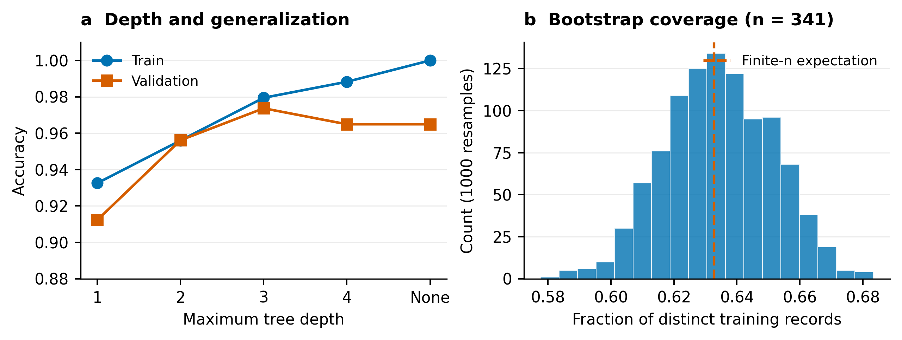
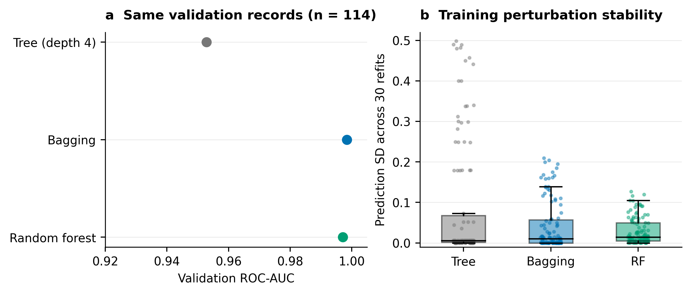
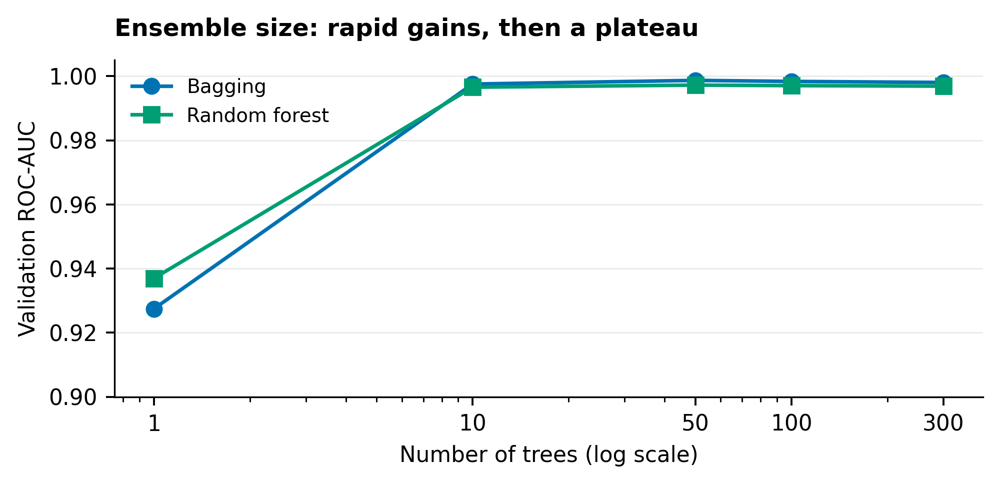
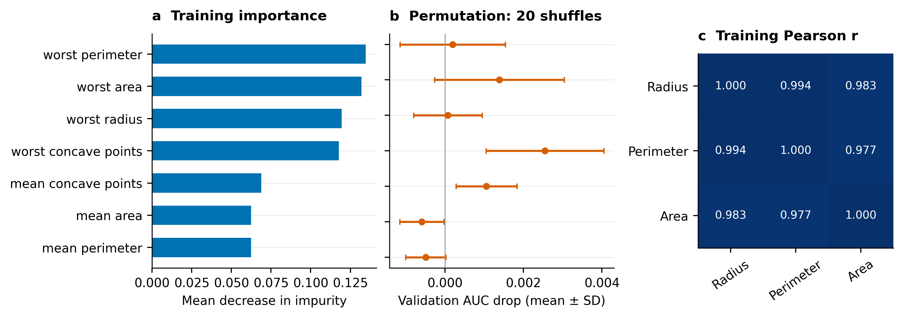
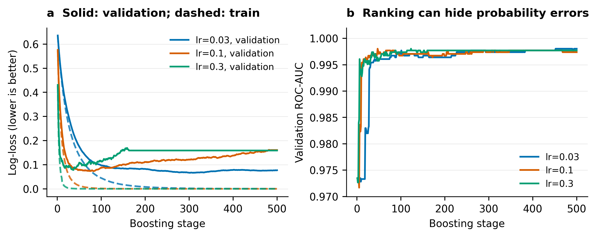
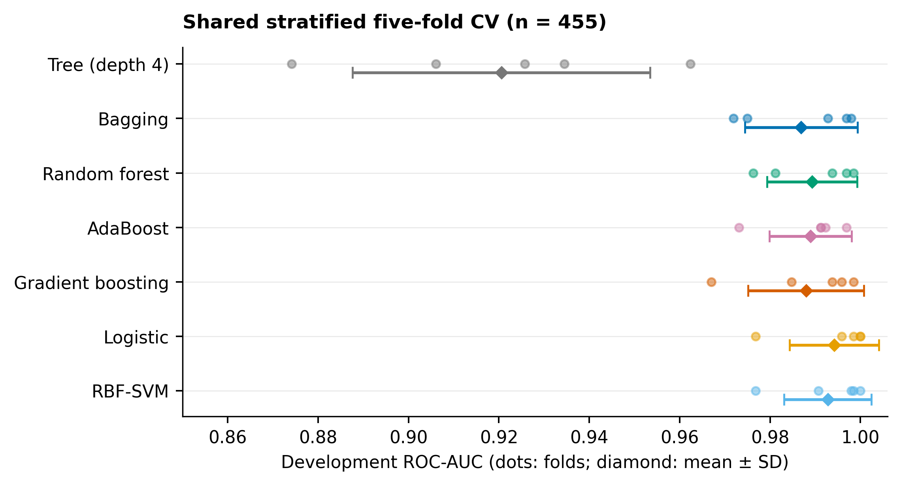

# 第 10 讲工作单：集成学习与 Bootstrapping

姓名：________  小组：________  日期：2026-11-16

研究问题：在同一数据和同一验证协议下，多个模型如何组合，是否真的带来更好的表现与更稳定的预测？请先写预测，再分析数据，最后用证据限制结论。你可以运行 `scripts/demo_ensemble.py` 作为起点，也可以自己写代码，分析内容不限于本工作单。

## 数据与协议

本课使用教师选定的一套数据（二选一）：

- 方案 A：WDBC 乳腺肿块细胞核特征，`data/`，标签 `malignant=1`。运行 `python scripts/demo_ensemble.py --data wdbc`。
- 方案 B：CTG 胎心监护信号特征，`data-ctg/`，标签 `pathologic=1`。同一 `recording_id` 的片段来自同一段录音，交叉验证时必须按它分组。运行 `python scripts/demo_ensemble.py --data ctg`。

演示结果写在项目根目录 `.tmp/ensemble/<数据名>/`。

**本次实验选择方案 A（课程默认 WDBC）。** 实验假设：集成应比单树稳定，但未必超过 LR / SVM。以下数字均为本机实际运行结果，不照抄教师参考。训练集 341 条（恶性 127），验证集 114 条（恶性 43），开发集 455 条；输入为 30 个特征，开发集无缺失、无重复特征行。114 条锁定测试记录未参与实验，也未读取其标签。

**统一协议：** seed=1010；全部模型共享原始划分及开发集分层五折；LR/SVM 用折内 `StandardScaler`。单树深度 4；bagging 用 100 棵不限深度、全特征树；RF 用 100 棵树、节点候选特征 `sqrt`；GB 用 100 轮、学习率 0.1、深度 3；LR 为 L2、C=1；SVM 为 RBF、C=1、gamma=scale。AUC 使用概率或 SVM 决策分数，类别使用默认规则；BA 为敏感度与特异度的平均。D/E 的参数曲线仅用于机制探索，不回填修改 F 中预设配置。

**复现与环境：** 在仓库根目录执行 `python "lesson9/10. Ensemble/scripts/complete_worksheet.py"`。本次 Python 3.11.3、sklearn 1.2.2、NumPy 1.24.0、pandas 1.5.3、Matplotlib 3.7.1，低于课程 requirements 的部分建议版本，未更改原环境；精确参数见 [运行记录](results/run-info.json)。尤其本机 AdaBoost 默认为 SAMME.R，与教师新版实现不同，因此不能混用参考数值。数据表保存在 [results/](results/)，图像有 PNG、PDF、SVG 三种格式。

1. 一行记录代表什么？`sample_id`（以及方案 B 的 `recording_id`）为什么不能作为输入？标签能否解释成未来患病概率？

   **答：** WDBC 每行是一份乳腺肿块细针穿刺图像的细胞核特征汇总，不是一颗细胞。ID 只用于追踪，可能让模型记住顺序或来源；CTG 的录音 ID 还用于防止同源片段跨折泄漏。标签是已有良恶性诊断，模型输出不能直接解释成未来患病概率。

2. 训练、验证、测试分别回答什么问题？为什么测试标签不能在选模型前打开？

   **答：** 训练集用于学习参数，验证集用于比较配置，测试集在方案锁定后评价最终泛化表现。提前查看测试标签会使选型间接适应测试集，破坏独立评价。本次只报告开发阶段结果；开发集 CV 与验证集有重叠，二者不是独立复验证据。

## A. 决策树：第一个知识点

1. 读课件第 5 页的示例树：一个 `worst perimeter = 120`、`mean concave points = 0.08` 的样本会落到哪个叶节点？预测恶性概率是多少？叶节点里的概率是怎么来的？

   **答：** 120 > 105.95，向右；0.08 > 0.05，再向右，落到“良 3、恶 112”叶节点。恶性概率为 112/(3+112)=**0.9739**，即该叶训练样本中的恶性比例，不是已经校准的个体风险。

2. 用自己的话解释：树在每个节点怎样选特征和阈值？Gini 不纯度衡量什么？

   **答：** 遍历候选特征和阈值，选择使左右子节点加权不纯度下降最多的切分。Gini = 1−Σpₖ²，衡量类别混杂程度，也可理解为按节点类别分布独立抽取两次时类别不同的概率；纯节点为 0。

3. 在你的数据上分别拟合 `max_depth` = 1、2、3、4、不限的树，记录训练和验证表现。树越深，训练表现和验证表现分别怎样变化？

| 最大深度 | 叶节点数 | 训练准确率 | 验证准确率 | 验证 ROC-AUC |
|---|---:|---:|---:|---:|
| 1 | 2 | 0.9326 | 0.9123 | 0.9158 |
| 2 | 4 | 0.9560 | 0.9561 | 0.9718 |
| 3 | 7 | 0.9795 | **0.9737** | **0.9735** |
| 4 | 11 | 0.9883 | 0.9649 | 0.9528 |
| 不限 | 17 | 1.0000 | 0.9649 | 0.9672 |

**观察：** 训练准确率持续上升；验证准确率在深度 3 最高，继续加深没有收益，出现过拟合迹象。



*图1：左图用相同训练/验证划分比较树深度，None 表示不限；右图为对 341 条训练记录抽样 1,000 次的独特样本占比分布，虚线是有限样本理论期望 0.63266。单次覆盖率有波动；加深树不能保证验证表现改善。数据：[树深度](results/tree-depth.csv)、[抽样模拟](results/bootstrap-simulation.csv)。*

4. 对训练集做几次 bootstrap 重抽样，各拟合一棵浅树，根节点的特征和阈值是否一样？这说明单棵树有什么问题？

   **答：** 10 次重抽样、深度 2、固定算法种子，根节点并不相同：

| 根特征 | 次数 | 对应阈值（各特征单位不同） |
|---|---:|---|
| worst perimeter | 4 | 105.95（2次）、113.15、113.75 |
| worst area | 3 | 865.40、884.75（2次） |
| worst radius | 2 | 16.795、17.480 |
| mean concave points | 1 | 0.05573 |

说明少量训练样本变化就能改变树结构，单树对训练扰动敏感、方差较高。不同特征阈值不能直接比较大小。[逐次记录](results/bootstrap-roots.csv)。

5. 为什么树模型通常不需要标准化，而 LR、SVM 需要？

   **答：** 树主要依赖特征内的次序，正比例换单位通常不改变候选切分。LR 的正则化与系数尺度有关，RBF-SVM 的距离与特征尺度有关，因此本实验对二者标准化；标准化参数只由各训练折拟合。

## B. 投票与“集成为什么有效”

对下表四个样本，三个模型预测如下。手算硬投票、软投票，并指出“多数票错了但概率均值更接近正确答案”的情况。

| 样本 | 真值 | 树1 | 树2 | 树3 | 概率1 | 概率2 | 概率3 |
|---|---:|---:|---:|---:|---:|---:|---:|
| A | 1 | 1 | 1 | 0 | .80 | .70 | .45 |
| B | 0 | 0 | 1 | 1 | .20 | .60 | .65 |
| C | 1 | 0 | 1 | 1 | .35 | .75 | .80 |
| D | 0 | 0 | 0 | 1 | .15 | .25 | .70 |

**手算结果（软投票阈值 0.5）：**

| 样本 | 硬投票 | 平均概率 | 软投票 | 是否正确 |
|---|---:|---:|---:|---|
| A | 1 | 0.6500 | 1 | 两者均正确 |
| B | 1 | 0.4833 | 0 | 硬错、软对 |
| C | 1 | 0.6333 | 1 | 两者均正确 |
| D | 0 | 0.3667 | 0 | 两者均正确 |

**B** 是关键反例：两张微弱的阳性票被一张更确信的阴性票抵消，平均概率低于 0.5，恢复正确分类；软投票也并非总比硬投票好。

课件第 8 页给出：B 个模型平均后的方差 = ρσ² + (1−ρ)σ²/B。不需要推导，用它回答：

1. 树数 B 不断增加时，方差会降到哪里为止？

   **答：** 等方差、等相关的近似条件下，B→∞ 时趋于 **ρσ²**；无法平均掉模型共有的波动。

2. 如果三棵树总是犯同样的错（ρ 接近 1），投票还有用吗？

   **答：** 收益很小；若三棵树完全相同，投票不会改变结果。式中的 ρ 是预测间的相关性，错误同步是多样性不足的直观表现。

3. 平均能降低偏差吗？为什么 bagging 适合深树，而不是本来就很稳定的逻辑回归？

   **答：** 对相同期望的基学习器，简单平均不改变其期望，不能保证消除偏差；主要降低方差。深树通常低偏差、高方差，更适合平均；稳定的 LR 收益通常较小，但并非所有数据上的 LR 都稳定。

## C. Bootstrap 与 bagging

1. 对索引 `[1,2,3,4,5]` 有放回抽 5 次，写出一次抽样，例如 `[2,2,5,1,2]`。哪些是重复样本？哪些是袋外（OOB）样本？

   **答：** 取 `[2,2,5,1,2]`：索引 2 出现 3 次，独特样本为 `{1,2,5}`，占 3/5=60%；OOB 为 `{3,4}`，占 40%。

2. 写一个小程序模拟 1,000 次，记录不同样本占比和袋外比例。它们为什么不是每次固定？平均值接近多少？

```python
import numpy as np
for n in (5, 341):
    rng = np.random.default_rng(1010)
    unique = np.array([
        np.unique(rng.choice(n, size=n, replace=True)).size / n
        for _ in range(1000)
    ])
    print(n, unique.mean(), (1 - unique).mean())
```

| 每次抽样数 n | 实测独特占比均值 | 实测 OOB 占比均值 | 理论独特占比 |
|---|---:|---:|---:|
| 5 | 0.67500 | 0.32500 | 0.67232 |
| 341（本训练集） | 0.63282 | 0.36718 | 0.63266 |

每次抽到的重复次数随机，所以占比不同。理论值为 `1−(1−1/n)^n`；**约 63.2% / 36.8% 是大样本近似，不能直接套到 n=5**。图1右侧展示 n=341 的实际分布。

3. 用一句话解释 bagging 如何制造多个训练集，为什么可以并行训练。

   **答：** 从同一训练集独立进行多次等量有放回抽样，每份训练一个模型；模型互不依赖前一轮结果，因此可并行。

4. OOB 误差是怎样算出来的？它能代替验证集做什么，不能代替什么？

   **答：** 对每条训练记录，仅汇总未抽到它的基树预测，再对所有具有 OOB 预测的记录计算误差；不是简单平均各树准确率。它可用于内部估计泛化误差、粗选参数，但反复据此调参也会产生选择偏差，不能替代最终锁定测试或外部验证。CTG 按行 OOB 会把同录音其他片段用于训练，应改用录音分组验证。

## D. 单树、bagging 与随机森林

比较单树、100 棵全特征 bagging、100 棵 `sqrt` 特征随机森林。填写：

| 模型 | 验证 ROC-AUC | balanced accuracy | 预测波动（SD 或类别翻转率） | 你观察到的机制 |
|---|---:|---:|---:|---|
| 单树（深度4） | 0.9528 | 0.9627 | SD=0.0855；翻转率24.56% | 一棵树容易随训练数据变化 |
| bagging（100棵） | 0.9984 | 0.9813 | SD=0.0415；翻转率15.79% | 重抽样后平均，预测波动减小 |
| random forest（100棵） | 0.9971 | 0.9581 | SD=0.0284；翻转率7.02% | 额外特征随机化，波动进一步减小 |

SD 为每个验证样本在 30 次共享 bootstrap 重训中的概率标准差（ddof=0），再对 114 个样本取平均；翻转率为至少出现过两种预测类别的样本比例，非逐次错误率。算法种子固定。上述差异支持稳定性改善；RF 验证 AUC 比 bagging 低 0.0013，并未在本划分上全面胜出。



*图2：左图为固定验证集 AUC 点估计；右图每点对应一个验证样本的重训概率 SD，箱体为四分位区间、中线为中位数，须线为 1.5×IQR 范围内的极值。集成减少大幅波动的样本；箱体不是模型性能置信区间。数据：[模型比较](results/model-comparison.csv)、[稳定性](results/prediction-stability.csv)、[重训预测](results/bootstrap-predictions.csv)。*

1. 为什么随机森林的特征随机化可能降低树之间的相关性？如果树的错误高度相关，增加树数一定有帮助吗？

   **答：** 每个节点仅从随机候选特征中选分裂，避免所有树反复依赖同一强特征，可能产生不同预测。高度相关时增加树数收益有限，仍受 ρσ² 下限约束。本实验没有直接估计 ρ，不能仅凭 SD 下降证明相关性已经下降。

2. 改变树数（如 1、10、50、100、300）。表现在哪里开始不再明显提高？树多了会过拟合吗？

| 树数 | Bagging 验证 AUC | RF 验证 AUC |
|---|---:|---:|
| 1 | 0.9274 | 0.9369 |
| 10 | 0.9975 | 0.9966 |
| 50 | 0.9987 | 0.9972 |
| 100 | 0.9984 | 0.9971 |
| 300 | 0.9980 | 0.9969 |

**答：** 约 10–50 棵后进入平台；50→300 棵并非单调提高。固定基树复杂度与抽样机制时，增加 bagging/RF 树数主要减少有限集成的随机波动，通常不会像 boosting 那样持续追随残差而过拟合，但无法修复已有偏差、数据泄漏或分布变化，计算成本也会上升。



*图3：横轴为树数的对数刻度。两类集成很快达到平台，更多树未带来可见收益；曲线来自一个种子、一个验证集，无误差条，不据此确定普适最佳树数。数据：[树数曲线](results/tree-count-curve.csv)。*

3. 比较不纯度重要性和置换重要性的前几名。两者是否一致？高度相关的特征（先看相关矩阵）在两种重要性里各是什么表现？

   **答：** 用 300 棵 RF 单独做解释实验。不纯度重要性前三为 worst perimeter（0.1348）、worst area（0.1320）、worst radius（0.1196）；验证集 AUC 置换重要性前三则是 worst concave points（0.00255）、worst texture（0.00155）、worst area（0.00138），排名不一致。

   在训练集上，worst radius / perimeter / area 两两 Pearson r 为 **0.994、0.983、0.977**。这些指标可分摊切分贡献、互相替补，单独置换 AUC 下降仅约 0.00007、0.00020、0.00138。不纯度重要性偏向切分机会多的特征；置换重要性受冗余和本验证集影响，接近零或为负不等于特征没有信息。二者均不是因果效应。



*图4：左、中面板展示不纯度重要性前7名的相同特征，便于逐项比较；中图误差条为20次置换的均值±SD，并非置信区间。右图是训练集三个尺度特征的相关矩阵。强相关指标在不纯度重要性中占比较大，却可互相替补。完整排名含 worst texture 等见 [重要性数据](results/feature-importance.csv)，相关矩阵见 [相关数据](results/train-feature-correlations.csv)。*

## E. Boosting 的顺序依赖

1. AdaBoost 下一轮为什么提高错分样本的权重？这与 bagging 的独立重抽样有什么不同？

   **答：** 提高错分样本的相对权重，使下一轮更关注当前难点；更新依赖前一轮结果，必须顺序进行。Bagging 各轮从原训练集独立重抽样，不针对前一棵树的错误调整分布。

2. Gradient Boosting 的新树拟合什么方向？用 `y-p` 描述二分类 log-loss 的负梯度。

   **答：** 以当前 logit 分数 F 为自变量，p=sigmoid(F)，log-loss 对 F 的负梯度为 **y−p**。新树拟合这个方向，再以学习率缩小后加到 F 上：阳性预测偏低时向上修正，阴性预测偏高时向下修正；它关注所有样本，不仅错分样本。

3. 改变 `learning_rate` 和 `n_estimators`，观察训练和验证的 log-loss 或 ROC-AUC。轮数太多时会发生什么？应该用什么决定轮数？

固定树深度3，在同一训练集上分别训练500轮，记录每一轮：

| 学习率 | 本验证集最低 log-loss 的轮数 | 最低验证 log-loss | 第500轮验证 log-loss | 第500轮验证 AUC |
|---|---:|---:|---:|---:|
| 0.03 | 302 | 0.0662 | 0.0769 | 0.9980 |
| 0.10 | 83 | 0.0731 | 0.1606 | 0.9974 |
| 0.30 | 36 | 0.0780 | 0.1588 | 0.9977 |

**答：** 较小学习率通常需要更多轮。学习率0.1时，验证 log-loss 在83轮最低，继续训练至500轮明显回升，但 AUC 仍接近0.997；概率可能越来越自信，排序指标却不敏感。应在开发阶段按预设验证损失或内层 CV 早停，不能按测试分数选轮数。表内最小值经过验证集选择，不是无偏最终性能；F 仍使用预设100轮配置。



*图5：左图实线为验证、虚线为训练 log-loss；右图为验证 AUC。训练损失接近零后，验证损失可回升，说明不能只看训练分数或 AUC 决定训练轮数。数据：[完整逐轮记录](results/boosting-curves.csv)。*

4. 查阅资料：XGBoost、LightGBM 和 sklearn 的梯度提升是什么关系？它们主要多了什么？（不要求安装运行。）

   **答：** 三者都属于梯度提升树家族。sklearn 提供经典 `GradientBoosting` 和直方图版本 `HistGradientBoosting`；XGBoost 显式加入树复杂度正则并利用一、二阶导数优化，还提供高效的树构建实现；LightGBM 采用直方图分箱和叶优先生长，强调速度、内存与大规模训练。叶优先生长在小数据上也可能过拟合；实现更快不保证本数据上更准确。上述为文档核验，不是本次安装或实测结论。[sklearn 官方指南](https://scikit-learn.org/stable/modules/ensemble.html)、[XGBoost 官方教程](https://xgboost.readthedocs.io/en/stable/tutorials/model.html)、[LightGBM 官方说明](https://lightgbm.readthedocs.io/en/stable/Features.html)（查阅日期：2026-11-16）。

## F. 公平比较与选型

在同一划分、同一指标下比较逻辑回归、RBF-SVM、随机森林和梯度提升（LR、SVM 在折内标准化；方案 B 按 `recording_id` 分组做交叉验证）。

| 模型 | 验证 ROC-AUC | balanced accuracy | 开发集 CV 均值 ± SD | 解释成本 |
|---|---:|---:|---:|---|
| 逻辑回归 | 1.0000 | 0.9930 | 0.9942 ± 0.0099 | 较低，可解释标准化系数；相关特征会影响系数 |
| RBF-SVM | 1.0000 | 1.0000 | 0.9928 ± 0.0096 | 较高，核边界不直观 |
| 随机森林 | 0.9971 | 0.9581 | 0.9893 ± 0.0100 | 较高，需聚合解释及重要性分析 |
| 梯度提升 | 0.9967 | 0.9581 | 0.9880 ± 0.0128 | 较高，需控制轮数、解释加性树模型 |

CV 列为开发集455条记录、**共享五折 ROC-AUC 的均值±折间样本 SD（ddof=1）**，不是95%置信区间。CV 不针对 E 中探索出的最优轮数重新选型。



*图6：每个圆点是一折 AUC，菱形及误差条为均值±折间SD。集成与单树差距较大，LR/SVM与集成之间差距较小。训练折互相重叠，不能把5个点当作5次独立实验做显著性宣称。数据：[逐折数据](results/cv-folds.csv)、[CV汇总](results/cross-validation.csv)。*

补充核对验证集混淆矩阵，以下按 `(TN, FP, FN, TP)` 记录：

| 模型 | TN | FP | FN | TP |
|---|---:|---:|---:|---:|
| 单树 | 69 | 2 | 2 | 41 |
| Bagging | 70 | 1 | 1 | 42 |
| RF | 70 | 1 | 3 | 40 |
| GB | 70 | 1 | 3 | 40 |
| LR | 70 | 1 | 0 | 43 |
| RBF-SVM | 71 | 0 | 0 | 43 |

1. 集成模型是否真的胜过简单基线？差距是否大于 CV 折间的波动？

   **答：** 本实验未显示集成胜过 LR/SVM。RF 相对单树 CV AUC 增加 **0.0688**，高于两者各自折间 SD（0.0100、0.0329）；但 RF 比 LR 低 **0.0049**、比 SVM 低 **0.0035**，均小于约0.01的折间 SD。后者仅是量级比较，不能据此证明显著差异或等效；无需强行选出统计赢家。

2. 结合课件第 14 页，说明在你的数据上会优先考虑哪一类模型，什么情况下会改选另一类。

   **答：** 优先 LR，保留 RBF-SVM 候选：样本较少、简单模型已表现很好，LR解释成本低。若独立数据证实有明显非线性或交互，且RF/GB在共同验证协议下持续改善关键指标，再考虑树集成；若必须直接阅读规则，可考虑浅树，但须接受性能和稳定性的代价。

## G. 稳定性与不确定性

对同一批 bootstrap 训练集分别训练模型，记录固定验证样本的预测标准差和类别翻转率。区分：模型对训练样本扰动的稳定性、固定已拟合模型指标的 bootstrap 区间、外部人群的不确定性。哪些可以由本课实验支持，哪些不能？

| 模型 | 30次重训的平均预测SD | 发生过类别变化的样本数/114 | 翻转率 |
|---|---:|---:|---:|
| 单树 | 0.0855 | 28/114 | 24.56% |
| Bagging | 0.0415 | 18/114 | 15.79% |
| RF | 0.0284 | 8/114 | 7.02% |
| LR（补充） | 0.0217 | 7/114 | 6.14% |
| GB（补充） | 0.0456 | 20/114 | 17.54% |

**结论：** 在相同训练扰动下，集成比单树稳定；LR的平均SD也较小，进一步支持将它保留为首选。均值可能掩盖个别边界样本的高波动，不能把平均稳定性当作每个人的可靠性保证。

| 不确定性类型 | 操作与含义 | 本次能否支持 |
|---|---|---|
| 训练样本扰动 | 训练集重抽样、重新拟合，观察同一验证样本预测变化 | 能；本次实测30次，算法种子固定，仅描述本训练分布下的敏感性 |
| 固定模型指标区间 | 模型不重训，只重抽评价记录并重算指标；比较模型时应共享抽样索引 | 本次未计算；上述SD不是这种区间，它也不包含重新训练、选型和分布变化 |
| 外部人群不确定性 | 换医院、人群或时间进行独立验证 | 不能；本课没有外部队列，也缺少患者分组与时间信息 |

## H. 研究备忘录与 bagging / boosting 对照

1. 填写对照表（必做作业）：

| 方面 | Bagging（含随机森林） | Boosting |
|---|---|---|
| 训练方式（并行 / 顺序） | 基学习器可并行，最后平均/投票 | 顺序叠加，后一轮依赖当前模型 |
| 每一轮用什么数据或权重 | 独立bootstrap；RF再随机选节点候选特征 | AdaBoost更新样本权重；GB拟合当前损失的负梯度 |
| 基学习器（深树 / 浅树） | 通常用不限深度或较深树 | AdaBoost常用树桩；GB通常用浅树 |
| 主要降低偏差还是方差 | 主要降方差，不保证降低偏差 | 主要逐轮修正偏差，也受方差与正则化影响 |
| 对噪声和轮数的敏感性 | 平均可缓和个别扰动；仍受系统性噪声影响，树数多通常趋于平台 | 对噪声、异常点和轮数较敏感，过多轮可能损害验证表现 |
| 关键超参数 | n_estimators、max_features、max_samples、min_samples_leaf、max_depth | learning_rate、n_estimators、max_depth/叶节点数、subsample及正则化参数 |

2. 写 250–400 字：在本数据和协议下，你会选择哪个模型或保留多个候选？证据必须同时提到表现、稳定性、解释成本和验证范围。写出一条会让你改变选择的后续证据。不要把特征重要性写成因果效应，也不要把测试排名写成临床结论。

**研究备忘录：**

在本次WDBC实验中，我优先选择逻辑回归，并保留RBF-SVM作为候选。两者验证AUC均为1.0000；开发集五折AUC分别为0.9942和0.9928，随机森林为0.9893，差距小于约0.01的折间波动，尚不足以宣布赢家。集成相对单树的价值主要是降低方差：共享30次bootstrap重训后，单树、bagging和随机森林的平均预测SD依次为0.0855、0.0415和0.0284；逻辑回归仅为0.0217。逻辑回归还能提供较易解释的系数，但相关特征会影响系数稳定性，不能作因果解释。Boosting轮数过多会使验证损失回升，不值得只为训练分数继续加树。上述证据仅限固定划分和开发集，未揭示锁定测试，也不能证明跨医院表现。若预先锁定协议的独立外部队列显示树集成持续改善AUC、敏感度与概率校准，且收益足以抵偿解释成本，我会改变首选。单一验证集满分也不代表总体误差为零。
